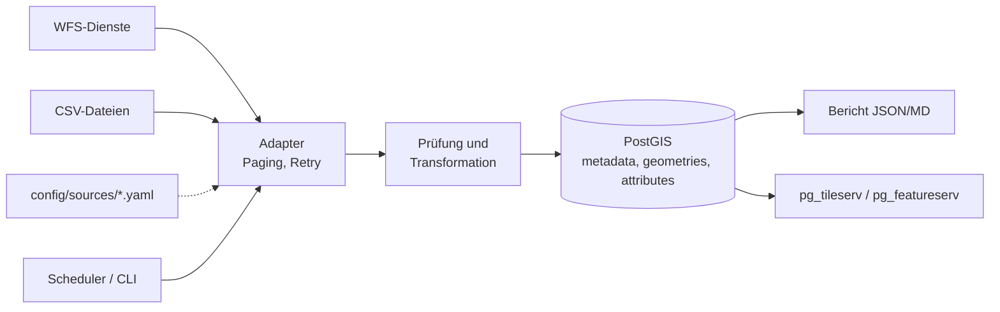

# geo-import-pipeline

[](https://github.com/julianmlrao/geo-import-pipeline/actions/workflows/ci.yml)
[](LICENSE)

Konfigurierbare Import-Pipeline für Geodaten aus **WFS-Diensten** und **CSV-Dateien** nach **PostgreSQL/PostGIS**.
Die Daten werden geprüft, nach EPSG:4326 transformiert und in ein einheitliches Modell aus drei Tabellen (Metadaten, Geometrien, Attribute) geschrieben.
Nach jedem Lauf entsteht ein Import-Bericht als JSON und Markdown. Neue Quellen werden über YAML-Dateien angebunden, ohne Codeänderung.

## Schnellstart

Voraussetzung: Docker mit Compose.

```bash
git clone https://github.com/julianmlrao/geo-import-pipeline.git && cd geo-import-pipeline
cp .env.example .env            # POSTGRES_PASSWORD setzen
docker compose up -d --build
docker compose exec importer geo-import run --all
docker compose exec importer geo-import report
```

Der erste Lauf holt 413 Brandenburger Gemeinden (WFS der LGB), 3.000 Hausadressen aus Potsdam (zweiter WFS, Punkte) und hängt Fläche und Einwohner aus einer CSV über den Amtlichen Gemeindeschlüssel an die Gemeindegeometrien. Die Antwortzeit der Dienste schwankt; der Lauf dauert meist zwei bis sieben Minuten.
Mit `make demo` (oder `./scripts/demo.sh`) läuft alles in einem Schritt.

Kartenansicht der Geometrien (optional): `docker compose --profile viewer up -d`, danach `http://localhost:7800` (pg_tileserv).

## Beispiel-Bericht (Auszug)

```
| Quelle                          | Status  | Neu  | Geändert | Gelöscht | Unverändert | Gesamt |
| `bb_gemeinden`                  | success |  413 |        0 |        0 |           0 |    413 |
| `bb_hausadressen_potsdam`       | success | 3000 |        0 |        0 |           0 |   3000 |
| `destatis_gemeinden_bevoelkerung` | success | 413 |       0 |        0 |           0 |    413 |
```

Der Bericht enthält außerdem Zeitstempel je Quelle, Laufzeit, Warnungen (z. B. neue oder fehlende Felder, reparierte Geometrien), Fehlerursachen ausgefallener Quellen und die Lizenzangaben.

## Architektur



Details: [docs/ARCHITEKTUR.md](docs/ARCHITEKTUR.md), [docs/DATENMODELL.md](docs/DATENMODELL.md), [docs/BETRIEB.md](docs/BETRIEB.md).

## Konfiguration

Eine Quelle ist eine YAML-Datei in `config/sources/`:

```yaml
source_id: bb_gemeinden
title: Gemeindegrenzen Brandenburg
type: wfs
url: https://isk.geobasis-bb.de/ows/vg_wfs
layer: app:gem
crs_source: EPSG:25833
page_size: 100
feature_key: ags            # stabiler Schlüssel aus der Quelle
mapping:                    # Quellfeld -> Zielattribut
  gem_name: name
  gem_art: gemeindeart
license: dl-de/by-2-0
attribution: "© GeoBasis-DE/LGB, dl-de/by-2-0 (Daten geändert)"
schedule: "0 3 * * 1"       # Cron, optional
mode: replace               # replace | history
```

Anleitung in fünf Schritten: [docs/NEUE_QUELLE.md](docs/NEUE_QUELLE.md).

## Ersetzen und Historisieren

Standard ist `replace`: Ein neuer Import ersetzt die Daten derselben Quelle atomar in einer Transaktion. Schlägt der Import einer Quelle fehl, bleibt ihr Bestand unverändert. Optional bewahrt `mode: history` Vorgängerstände (Gültigkeitszeitraum `valid_from`/`valid_to`). Der Modus ist je Quelle einstellbar und standardmäßig aus.

## Befehle

| Befehl | Zweck |
|---|---|
| `geo-import run --all` / `--source ID` | Import jetzt |
| `geo-import validate-config` | YAML-Dateien prüfen |
| `geo-import list-sources` | Quellen und Zeitpläne |
| `geo-import report [latest\|ID] [--format json]` | Bericht ausgeben |
| `geo-import schedule` | Scheduler (Container-Standard) |

## Entwicklung

```bash
uv sync --extra web
docker run -d --name pg -e POSTGRES_PASSWORD=pw -e POSTGRES_DB=geo -p 55432:5432 postgis/postgis:16-3.4
export GEO_IMPORT_TEST_DSN="host=localhost port=55432 dbname=geo user=postgres password=pw"
uv run pytest -q && uv run ruff check . && uv run mypy src
```

Tests laufen ohne Netz (aufgezeichnete bzw. synthetische WFS-Antworten); Datenbanktests werden ohne `GEO_IMPORT_TEST_DSN` übersprungen.

## Demo-Weboberfläche

`docker-compose.prod.yml` ergänzt Weboberfläche (Anmeldung, Karte, Berichte, Import-Knopf), `pg_tileserv`, `pg_featureserv` und Caddy. Siehe [docs/BETRIEB.md](docs/BETRIEB.md).

## Lizenz und Datenquellen

Code: [Apache-2.0](LICENSE). Drittkomponenten: [THIRD_PARTY_LICENSES.md](THIRD_PARTY_LICENSES.md).
Die verwendeten Daten (LGB Brandenburg, Destatis) stehen unter der Datenlizenz Deutschland – Namensnennung – Version 2.0; Quellen und Abrufdatum in [docs/QUELLEN.md](docs/QUELLEN.md).
